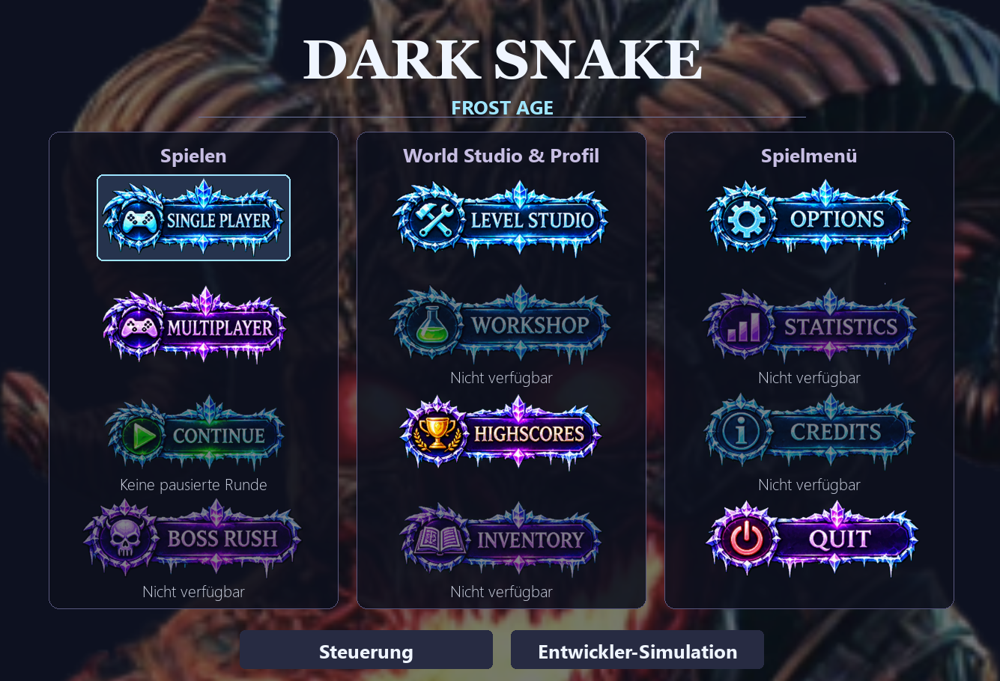

<p align="center">
  
</p>

<h1 align="center">🐍 DARK SNAKE</h1>
<p align="center"><strong>Arcade-Snake mit Roguelite-Ideen, Bosskämpfen, Elementareffekten und einer wachsenden Level-Werkstatt.</strong></p>
<p align="center"><a href="README.md">English 🇬🇧</a> · <strong>Deutsch</strong> · <a href="https://github.com/DemusOpalium/dark-snake-game/discussions">Mitdiskutieren</a> · <a href="ROADMAP.md">Roadmap</a></p>

> 🚧 **Spielbare Alpha in aktiver Entwicklung.** DARK SNAKE ist das Hobbyprojekt von DemusOpalium, persönlich gespielt und getestet, gemeinsam mit Irian und KI-gestützter Entwicklung umgesetzt. Das große FrostAge-Bild oben ist eine **Konzeptgrafik**, kein Spiel-Screenshot.

## 🎮 So sieht das Spiel aus

| Neues FrostAge-Hauptmenü | Bosskampf |
| :---: | :---: |
|  |  |

**Worum geht's?** Eine Schlange steuern, Punkte und Items einsammeln, Gegnern und Projektilen ausweichen und auftauchende Bosse überstehen. Du startest mit **drei Leben**. Klassisches Snake trifft auf Zeitereignisse, Lebenspunkte, Portale, Schüsse, Überraschungen und ein **W20-Würfelereignissystem**. Die Arcade-Runde funktioniert bereits; die größere Roguelite-Abenteuerwelt wächst erst noch.

Allein oder lokal zu zweit spielen, die Schlange gestalten und eigene Hintergrundmusik verwenden. Mal hektisch, mal einfach entspannt Punkte jagen — und vielleicht noch eine Runde versuchen.

## 🛠️ World Studio — eigene Level gestalten

<p align="center"></p>
<p align="center"><em>World Studio am 13. November 2026 — noch im Ausbau. Nicht jede geplante Funktion ist bereits verfügbar.</em></p>

Mit **F2** öffnet sich der Editor. Bereits vorhanden: **495 Classic-Tiles**, **175 neue FrostAge-PNGs**, große **Multi-Tile-Grafikobjekte**, benannte Kartenentwürfe, Themenwelten, Undo/Redo und isolierte **1P-/2P-Leveltests** für WALL/BARRIER, Schaden und Slow. Die neuen FrostAge-Grafiken sind außerdem als echte Buttons im Hauptmenü im Einsatz.

**Noch nicht fertig:** eine echte Dach-/Vordergrundebene mit transparentem Sichtkreis, dynamische Beleuchtung, die vergrößerte Editor-Oberfläche, spielbare Profile für die neuen FrostAge-Gegner/Projektile/Items und ein vollständiger Adventure-Ablauf. Im regulären Classic-Modus werden eigene Karten bisher als **Hintergrund** verwendet. Die erstellten Kollisionen und Effekte funktionieren derzeit im **isolierten Editor-Spieltest**.

Geplant sind unter anderem Brücken zum Unterqueren, Höhlen, leuchtende Frostkristalle, Pilzwelten, Fallen, interaktive Truhen und später mehr Roguelite-Fortschritt. Details stehen in der [Roadmap](ROADMAP.md).

## ⬇️ Windows-Alpha ausprobieren

Die **[FrostAge Alpha-Vorabversion vom 13. November 2026](https://github.com/DemusOpalium/dark-snake-game/releases/tag/frostage-alpha-2026-11-13)** steht unter GitHub Releases direkt zum Herunterladen bereit. `DARK-Snake-v1.0.0-Windows-x64.zip` herunterladen, vollständig entpacken und `DARK-Snake.exe` starten. Mit der zugehörigen `.sha256`-Datei lässt sich der Download prüfen. **Die EXE ist nicht digital signiert**; Windows oder der Browser können Warnungen anzeigen. Ein stabiles, signiertes Release gibt es **noch nicht**. Weitere Test-Builds entstehen über [GitHub Actions](https://github.com/DemusOpalium/dark-snake-game/actions/workflows/python-app.yml). Siehe [Windows-Anleitung](WINDOWS_BUILD.md).

Alternativ aus dem Python-Quellcode:

```bash
python -m pip install -r requirements.txt
python Dark_Snake/main.py
```

## ⌨️ Steuerung auf einen Blick

| Aktion | Standard |
| --- | --- |
| Bewegung Spieler 1 / Spieler 2 | WASD / Pfeiltasten |
| Schießen | Leertaste (P1), + (P2) |
| World Studio | F2 |
| Entwickler-Panel | Tab |
| Pause / Navigation | P / Esc |

Tasten lassen sich im Spiel anpassen. Mehr unter [Steuerung](CONTROLS.md). Das Hauptmenü lässt sich mit Maus, Tastatur und unterstütztem Controller bedienen. **Continue** setzt eine unterbrochene Runde fort, solange das Spiel geöffnet bleibt. Workshop, Boss Rush, Inventar, Statistik und Credits sind derzeit sichtbar als **nicht verfügbar** markiert.

## 🤝 Gemeinsam weiterentwickeln

DARK SNAKE entsteht Stück für Stück als langfristiges Hobbyprojekt. Ich spiele selbst, entdecke Fehler und interessante Ideen und entwickle das Spiel weiter. Wer testen, Rückmeldung geben oder mitentwickeln möchte, ist herzlich willkommen. Es geht um Spaß am Spielen und Gestalten — nicht darum, das perfekte Spiel zu behaupten.

**[💬 Discussions](https://github.com/DemusOpalium/dark-snake-game/discussions)** · **[🐛 Issues](https://github.com/DemusOpalium/dark-snake-game/issues)** · **[🛣️ Roadmap](ROADMAP.md)** · **[📷 Galerie](GALLERY.md)**

**Lizenz:** [MIT](LICENSE). Entstanden mit Python, pygame und der Zusammenarbeit von Mensch und KI. 🐍
