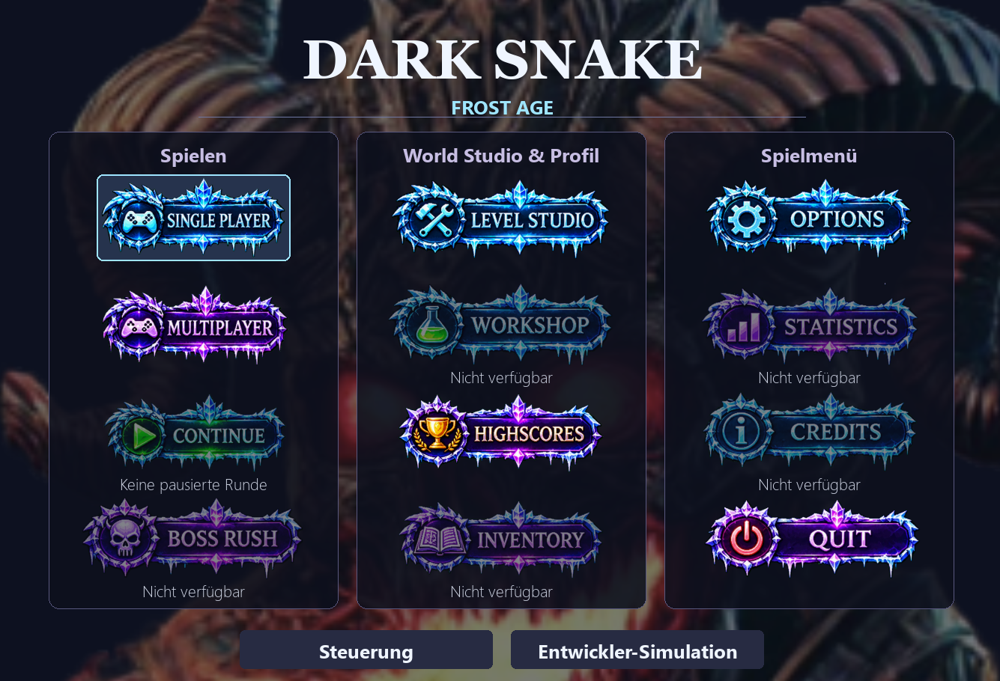

<p align="center">
  
</p>

<h1 align="center">🐍 DARK SNAKE</h1>
<p align="center"><strong>Arcade Snake with roguelite ambitions, boss battles, elemental chaos and a growing world editor.</strong></p>
<p align="center"><strong>English</strong> · <a href="README.de.md">Deutsch 🇩🇪</a> · <a href="https://github.com/DemusOpalium/dark-snake-game/discussions">Join the discussion</a> · <a href="ROADMAP.md">Roadmap</a></p>

> 🚧 **Playable, actively developed alpha.** This is a hobby game made by DemusOpalium, developed and playtested personally with help from Irian and AI-assisted coding. The picture above is **FrostAge concept artwork**, not gameplay footage.

## 🎮 A quick look

| FrostAge main menu | Boss fight |
| :---: | :---: |
|  |  |

**The point?** Guide your snake, collect points and items, survive enemies and incoming attacks, and stay alive when bosses appear. You begin with **three lives**. The action mixes classic Snake with timed events, health, projectiles, portals, a **D20 dice-event system**, unusual bonuses and increasingly unpredictable situations. The core is arcade; the broader roguelite adventure is still in development.

Play alone or locally with a second player. Choose your snake's appearance and play your own background music. Some encounters are frantic; others are just a chance to relax, chase a score and try another run.

## 🛠️ World Studio — build your own maps

<p align="center"></p>
<p align="center"><em>World Studio captured on 13 November 2026 — an evolving editor, not a finished showcase of every planned feature.</em></p>

Press **F2** to open the editor. Already available: **495 classic tiles**, the new **175 FrostAge PNG assets**, large **multi-tile graphics**, named level drafts, themed world organization, Undo/Redo and isolated **1P/2P playtests** for wall/barrier collisions and Damage/Slow fields. The new FrostAge artwork also powers the illustrated main-menu buttons.

**Current limits:** Roof/Foreground rendering, a see-through roof circle, dynamic lighting, a more spacious editor UI, new FrostAge enemy/projectile/item gameplay profiles, and a complete custom-level adventure are **planned, not finished**. Classic currently applies selected user maps as backgrounds; authored collisions/effects are tested in the **isolated editor playtest**.

Upcoming ideas include bridges you can pass underneath, icy caverns with glowing crystals, mushrooms, traps, interactive chests, themed enemies and a fuller roguelite progression. Our [roadmap](ROADMAP.md) tracks these separately.

## ⬇️ Try the Windows alpha

The **[FrostAge Alpha pre-release (13 November 2026)](https://github.com/DemusOpalium/dark-snake-game/releases/tag/frostage-alpha-2026-11-13)** is available directly on GitHub Releases. Download `DARK-Snake-v1.0.0-Windows-x64.zip`, extract it completely and launch `DARK-Snake.exe`. The accompanying `.sha256` file lets you verify the download. **The EXE is unsigned**, and Windows or browsers may display warnings. A stable, signed release is **not yet available**. Further test builds appear in [GitHub Actions](https://github.com/DemusOpalium/dark-snake-game/actions/workflows/python-app.yml). See the [Windows guide](WINDOWS_BUILD.md).

Run from Python source instead:

```bash
python -m pip install -r requirements.txt
python Dark_Snake/main.py
```

## ⌨️ Controls & game modes

| Action | Default |
| --- | --- |
| Player 1 / Player 2 movement | WASD / arrow keys |
| Fire | Space (P1), + (P2) |
| World Studio | F2 |
| Developer panel | Tab |
| Pause / navigation | P / Esc |

Bindings can be customized in-game; see [full controls](CONTROLS.md). The main menu supports mouse, keyboard and mapped controller inputs. **Continue** resumes an interrupted round while the game remains open. Some menu entries (Workshop, Boss Rush, Inventory, Statistics, Credits) are currently shown as **unavailable** rather than claiming features that do not exist yet.

## 🤝 A game that grows through playing

DARK SNAKE is a long-term personal project, developed step by step rather than rushed into a release. I play it, find what feels fun or frustrating, adjust it, and play again. Bugs, ideas, suggestions and contributions from other players are welcome — no need to be an expert.

**[💬 Discussions](https://github.com/DemusOpalium/dark-snake-game/discussions)** · **[🐛 Issues](https://github.com/DemusOpalium/dark-snake-game/issues)** · **[🛣️ Roadmap](ROADMAP.md)** · **[📷 Gallery](GALLERY.md)**

**License:** [MIT](LICENSE). Made with Python, pygame, and human–AI collaboration. 🐍
