<p align="center">
  
</p>

# 🐍 DARK SNAKE

### 🎮 Windows-Download

Die erste offizielle Windows-Version ist in Vorbereitung. Sobald sie verfügbar ist, findest du die Windows-ZIP auf der [GitHub-Release-Seite](https://github.com/DemusOpalium/dark-snake-game/releases).

- ✅ Kostenlos
- ✅ Für Windows 11
- ✅ Keine Python-Installation erforderlich

**Installation nach der Veröffentlichung:** Windows-ZIP aus dem Release herunterladen, vollständig entpacken und die DARK-Snake-EXE starten.

[Windows-Build, SHA-256 und Hinweise zu Firefox](WINDOWS_BUILD.md)

<!-- Nach Veröffentlichung von v1.0.0 und Prüfung des Windows-ZIP-Assets die Überschrift in „🎮 Jetzt kostenlos spielen!“ ändern, den Statusabsatz durch [**⬇️ DOWNLOAD – Neueste Windows-Version**](https://github.com/DemusOpalium/dark-snake-game/releases/latest) ersetzen und „nach der Veröffentlichung“ entfernen. -->

*Eine düstere Snake-Reinkarnation mit Bossfights, Portalen, Effekten, Items und integriertem Level-Editor mit 495 Kacheln.*

---

## ✨ Ein visueller Einstieg in das Spiel

<p align="center">
  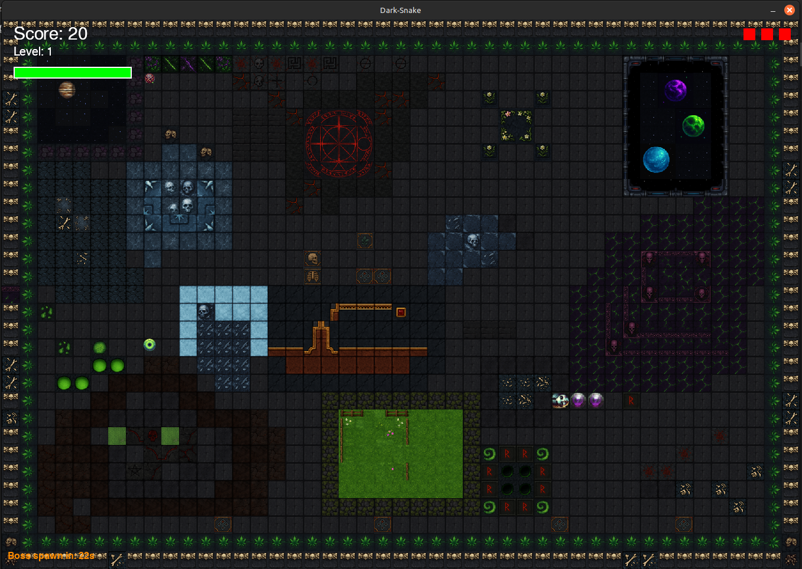
</p>

*Beispiel-Level mit vollständig belegtem Editorfeld – erzeugt mit dem neuen integrierten LevelEditor.*

<p align="center">
  
</p>

<p align="center">
  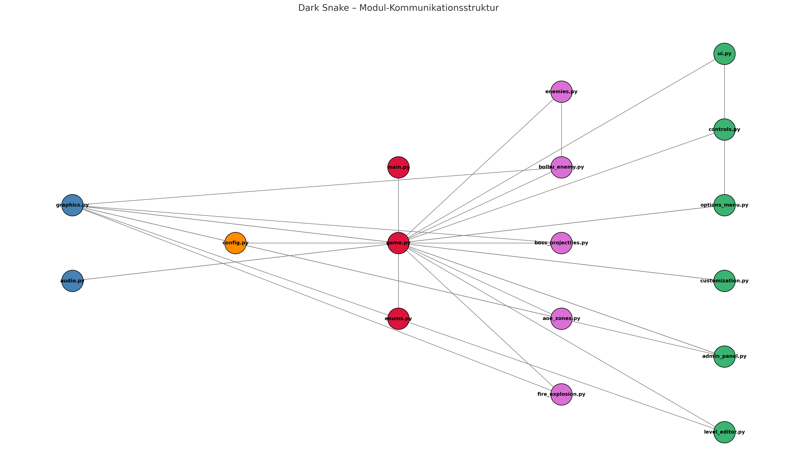
</p>

---

## 🔹 Was ist *Dark Snake*?

**Dark Snake** ist ein modular entwickeltes Indie-Snake-Spiel mit einzigartigem Grafikstil, Bossfights, automatischem Feuerschuss, Spezialprojektilen, AOE-Zonen, individuell gestaltbaren Snake-Designs – und einem vollständig integrierten, visuell gestalteten LevelEditor.

> **Hinweis von DemusOpalium:** Das Projekt entstand als Herzblutarbeit trotz MS-Erkrankung. Diese README wurde mit Hilfe von GPT4.5 erstellt, um das Projekt bestmöglich für Spieler und Entwickler zu dokumentieren.

---

## 🔺 Update-History & aktuelle Highlights (Alpha 2)

* ✅ Neuer Bossschuss: **BossFlameProjectile** (visuell & explosiv)
* ✅ AdminPanel-Update: **Bolbu-Spawns**, **AOE-Zonen**, **Sofort-Debug-Actions**
* ✅ Editor mit über **500 Tiles** aus `assets/graphics/tiles`
* ✅ Voll funktionaler 2-Spieler-Modus
* ✅ Hintergrundmusik-System (einfach mp3/wav einwerfen)

---

## 🔸 Inhaltsverzeichnis

* [Features im Überblick](#features-im-überblick)
* [LevelEditor Highlights](#leveleditor-highlights)
* [Screenshots](#screenshots)
* [Steuerung](#steuerung)
* [Installation & Start](#installation--start)
* [Modulstruktur & Doku](#modulstruktur--doku)
* [Download, Lizenz & Kontakt](#download-lizenz--kontakt)

---

## 🌟 Features im Überblick

| Feature            | Beschreibung                                                        |
| ------------------ | ------------------------------------------------------------------- |
| 🧠 KI-Gegner       | Gegner mit Spawnverhalten, Health, Projektile                       |
| 🔥 FireProjectile  | Spieler-Feuerball mit Explosionseffekt bei Aufprall                 |
| 🌌 AOE-Zonen       | Damage / Heal / Slow / Buff-Aura / Hintergrundbild                  |
| 🐉 Boss-System     | Flammenangriffe, Spezialeffekte, Animation, AoE                     |
| 🎨 Editor          | 495 Kacheln, Favoriten, benannte Entwürfe und Vorschau (F2)          |
| 🛠️ Adminpanel     | Spawn von Items, Feinden, AOE-Zonen, Effekte (TAB)                  |
| 👥 2-Spieler-Modus | Geteilte Healthbars, getrennte Steuerung & Designs                  |
| 🎵 Musikplayer     | Eigene Musikdateien auswählbar im Optionen-Menü (dauerhaft loopbar) |
| 🎭 Anpassung       | Spieler-Kopf- und Körpergrafiken über Inventarsystem auswählbar     |

---

## 🔧 LevelEditor Highlights

**F2** öffnet die Werkstatt. Entwürfe liegen als eigene JSON-Dateien in
`~/.dark-snake/levels/`. Der Editor bietet 495 Kacheln, Favoriten,
Rückgängig/Wiederholen und eine visuelle Kartenvorschau. Gespeicherte Karten
lassen sich für die nächste Classic-Runde als Hintergrund auswählen.
[Anleitung zur Werkstatt](DEVELOPMENT_NOTES.md#level-studio-11--entwürfe-bearbeiten)

---

## 🌄 Screenshots

### Spielszene mit AOE-Zonen und Items

<p align="center">
  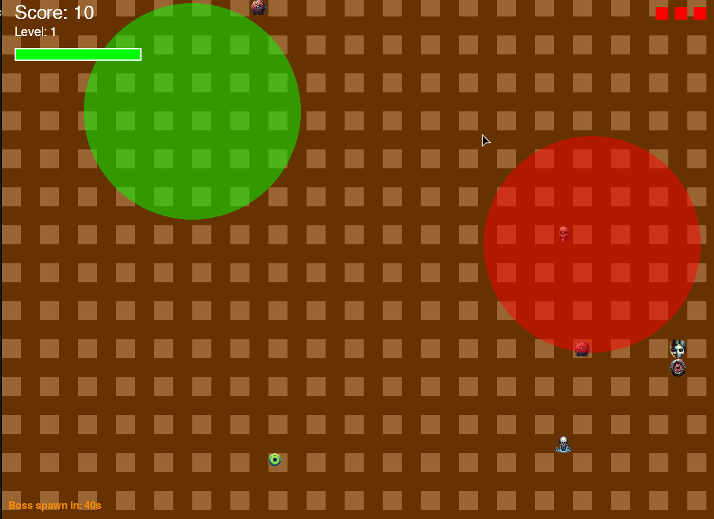
</p>

### Optionen / Snake-Designs

<p align="center">
  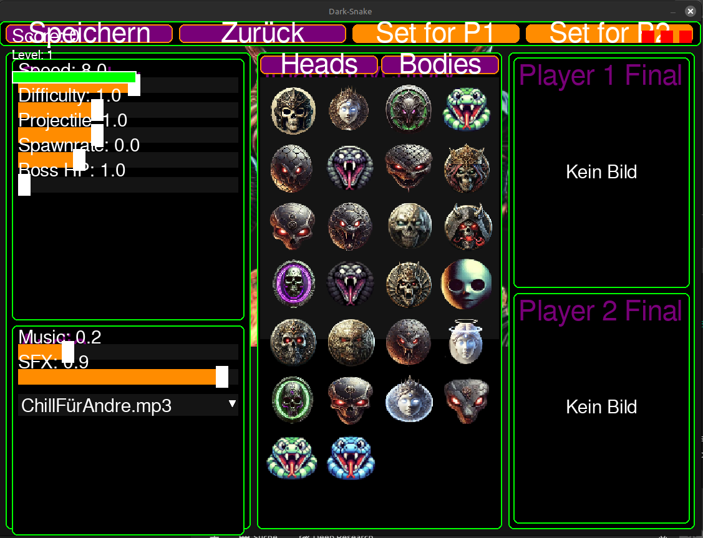
  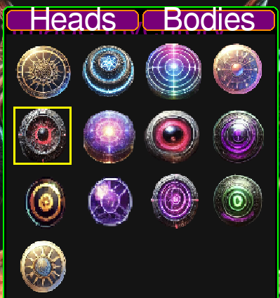
</p>

### AdminPanel & Effekte

<p align="center">
  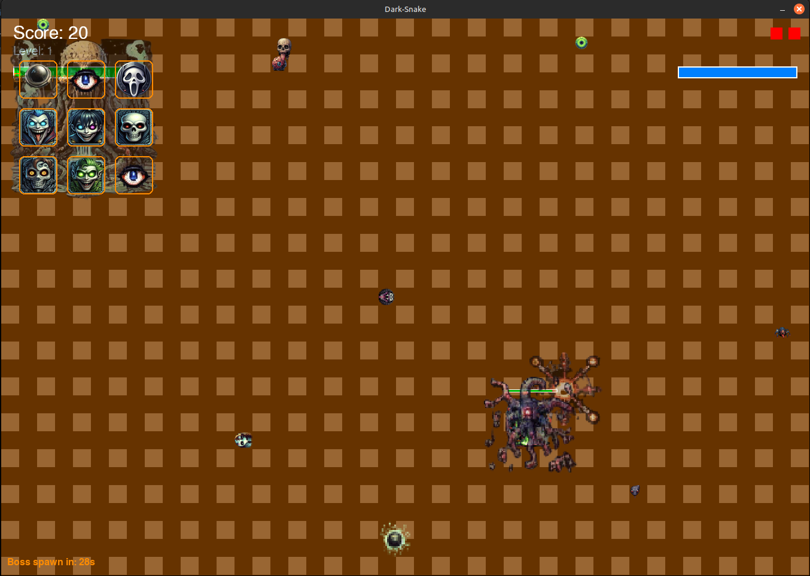
  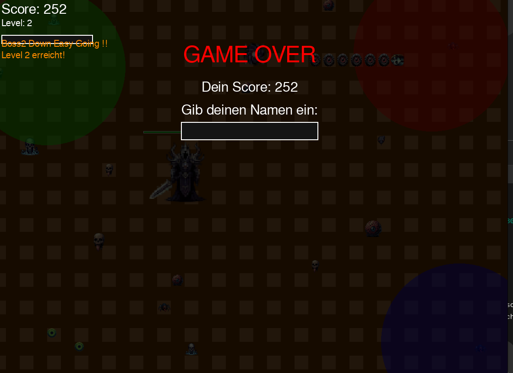
</p>

### Musik- und Hintergrundoptionen

<p align="center">
  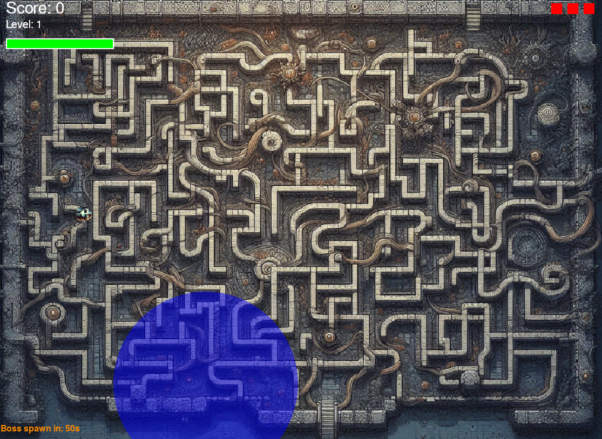
  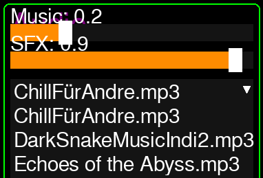
</p>

### Portal, Boss, Leaderboard

<p align="center">
  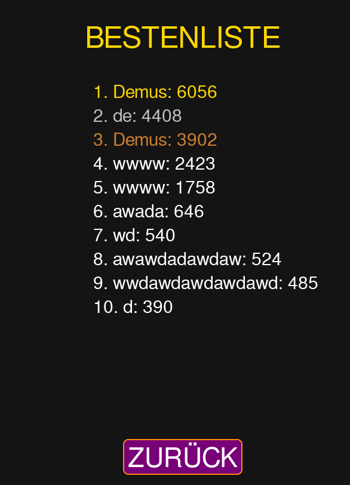
  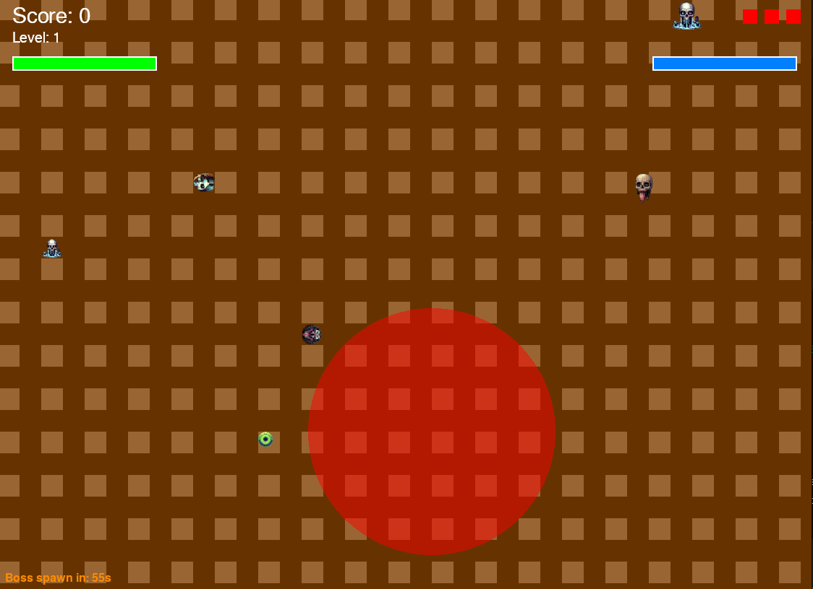
</p>

---

## ⌨ Steuerung

| Taste           | Funktion                              |
| --------------- | ------------------------------------- |
| **WASD**        | Bewegung Spieler 1                    |
| **Pfeile**      | Bewegung Spieler 2                    |
| **Space / +**   | Feuerball Spieler 1/2                 |
| **TAB**         | Admin-Panel öffnen                    |
| **F2**          | Editor starten                        |
| **Ü**           | Spezial-Hintergrund-Effekt aktivieren |
| **R/T/Z/U/I/O** | AOE-Zonen auslösen (Debug/Test)       |
| **ESC**         | Zurück ins Hauptmenü                  |

---

## 📁 Installation & Start

```bash
python -m pip install -r requirements.txt
python Dark_Snake/main.py
```

Der Startbefehl funktioniert aus dem Hauptordner des Repositorys. Audio ist optional;
ohne Audiogerät läuft das Spiel stumm weiter. Windows-Builds entstehen über den
Workflow **Build Windows EXE**. Technische Details stehen in `PROJECT_STATE.md`.

### Headless-Entwicklersimulation

Mehrere beschleunigte Runden aller festen Gameplay-Szenarien lassen sich ohne
Fenster, Audioausgabe oder Echtzeit-Wartezeiten ausführen:

```bash
python Dark_Snake/developer_simulator.py --rounds 5 --seed 12345
```

Nach jedem Batch entstehen ein TXT- und ein JSON-Bericht mit Zeitstempel und Seed.
Bei der entpackten Windows-Version liegt der Ordner **Entwicklerberichte** neben
der EXE, sofern er beschreibbar ist. Andernfalls und beim Start aus dem Quellcode
liegen die Berichte unter `~/.dark-snake/Entwicklerberichte`. Mit
`--output PFAD` lässt sich für einen Konsolenlauf ein anderer Ordner angeben.
Im Spiel zeigt die Entwickler-Simulation den letzten Bericht und öffnet den
tatsächlichen Ablageort über **Berichtsordner öffnen**.

Ein Exit-Code ungleich null meldet einen Spielfehler, eine technische Ausnahme,
eine Zeitüberschreitung, einen Abbruch oder einen Fehler beim Speichern. Der
Bericht weist nicht ausgeführte Spielregelprüfungen einzeln aus.

---

## 📚 Modulstruktur & Doku

* **Modulstruktur –** [DEV\_STRUCTURE.md](DEV_STRUCTURE.md)
* **Screenshots & Galerie –** [GALLERY.md](GALLERY.md)
* **Steuerung im Detail –** [CONTROLS.md](CONTROLS.md)
* **GPT Prompt-Guide –** [PROMPT\_GUIDE.md](PROMPT_GUIDE.md)
* **Roadmap & ToDo-Liste –** [ROADMAP.md](ROADMAP.md)

---

## 📤 Download, Lizenz & Kontakt

* Projektlizenz: **MIT License**
* Repo: [github.com/DemusOpalium/dark-snake-game](https://github.com/DemusOpalium/dark-snake-game)
* Spielversionen: [GitHub-Releases](https://github.com/DemusOpalium/dark-snake-game/releases)
* Quellcode für Entwickler: ZIP-Download oder Klonen via Git

> Entwickelt mit ❤️, Python, GPT4.5 und unermüdlichem Willen.
> Dieses Projekt ist mehr als ein Spiel: Es ist ein sichtbarer Beweis für kreative Kraft trotz Krankheit, Einschränkung und Widerstand.
