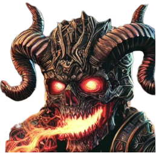
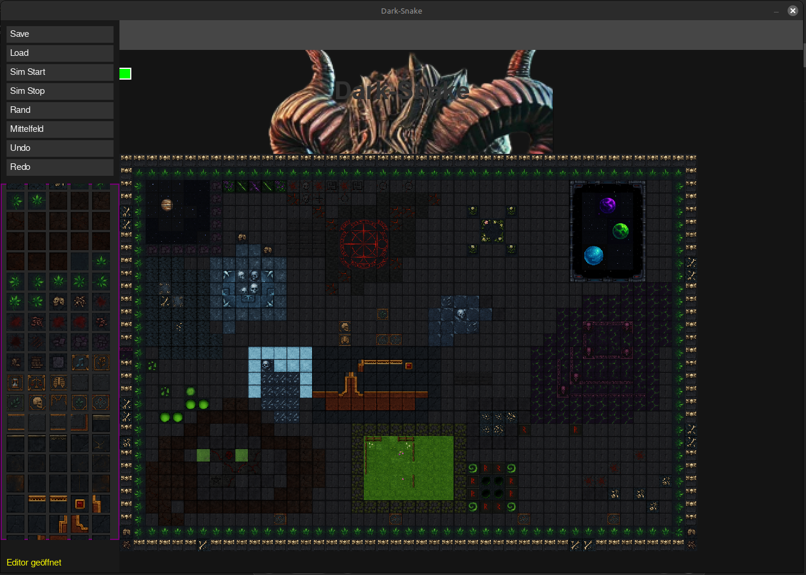

<p align="center">
  
</p>

<h1 align="center">🐍 DARK SNAKE</h1>

<p align="center">
  <strong>Classic Snake meets gothic arcade chaos.</strong><br>
  Boss fights · Co-op for two · Portals · Elemental effects · World Studio
</p>

<p align="center">
  <strong>English</strong> · <a href="README.de.md">Deutsch 🇩🇪</a> ·
  <a href="https://github.com/DemusOpalium/dark-snake-game/discussions">Community & feedback</a> ·
  <a href="ROADMAP.md">Roadmap</a>
</p>

> 🚧 **Active hobby project / alpha.** Made by DemusOpalium with AI-assisted development, curiosity and a love of games. Free to explore and test; not a finished commercial release.

## 🎮 See the game

<p align="center">
  
</p>
<p align="center"><em>Actual game screenshot from an earlier build, with the developer panel open.</em></p>

**What can you play?** A fast-moving Snake arcade game with boss encounters, enemies, projectiles, portals, items and two-player controls. Customize your snake and use your own background music.

<p align="center">
  
</p>
<p align="center"><em>World Studio: design and save your own maps. The editor is being expanded.</em></p>

## ❄️ World Studio & FrostAge

**Already available:** Press **F2** to use the level editor, browse **495 classic tiles**, save named JSON drafts, organize themed worlds and test **WALL/BARRIER**, **Damage** and **Slow** fields in isolated one- or two-player tests.

**Important:** The regular Classic mode currently uses selected maps as **backgrounds only**. Custom wall collisions and effect fields work in the **editor playtest**, not yet in normal Classic gameplay.

**Coming next:** Multi-size tiles and stamps, a clearer editor UI, foreground roofs with see-through areas, flickering lights, triggers and fully playable custom levels.

🎨 **126 new FrostAge PNG assets** are already stored in [the source asset folder](GamePICs/Incoming/Frost_Tiles/). They are **not yet integrated into the in-game tile loader**.

## ⬇️ Try it on Windows

A stable, downloadable Windows release is **not published yet**. The project builds Windows test versions through [GitHub Actions](https://github.com/DemusOpalium/dark-snake-game/actions/workflows/python-app.yml); a GitHub sign-in may be required to download an artifact. These test builds are not signed releases.

After downloading the Windows build artifact, extract the archive and the game ZIP completely before launching the EXE. See [Windows build and safety notes](WINDOWS_BUILD.md).

**Run from source** (Python / pygame):

```bash
python -m pip install -r requirements.txt
python Dark_Snake/main.py
```

## ⌨️ Controls at a glance

| Action | Default key |
| --- | --- |
| Player 1 / Player 2 movement | WASD / Arrow keys |
| Fire | Space (P1), + (P2) |
| Level editor | F2 |
| Developer panel | Tab |
| Back / pause navigation | Esc |

Key bindings and other options can be customized in-game. For details, see [controls](CONTROLS.md).

## 🤝 Join the project

Have a bug report, a map idea, or simply want to try DARK SNAKE? We'd love to hear what works and what doesn't.

**[💬 Discussions](https://github.com/DemusOpalium/dark-snake-game/discussions)** · **[🐛 Issues](https://github.com/DemusOpalium/dark-snake-game/issues)** · **[🛣️ Roadmap](ROADMAP.md)**

For development details: [World Studio notes](DEVELOPMENT_NOTES.md) · [Game gallery](GALLERY.md) · [Windows build guide](WINDOWS_BUILD.md).

**License:** [MIT](LICENSE). Built with Python, pygame and human–AI collaboration. 🐍
